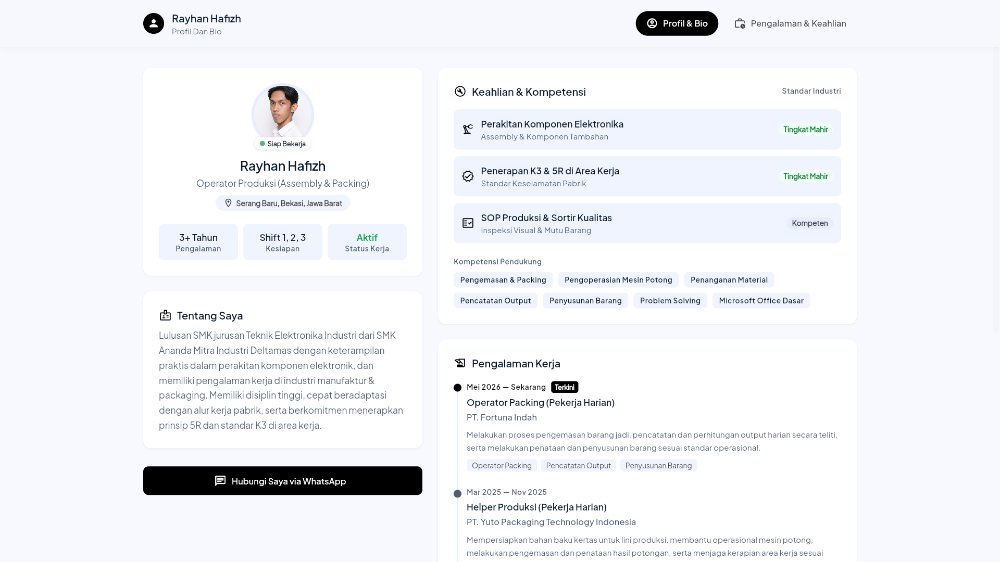
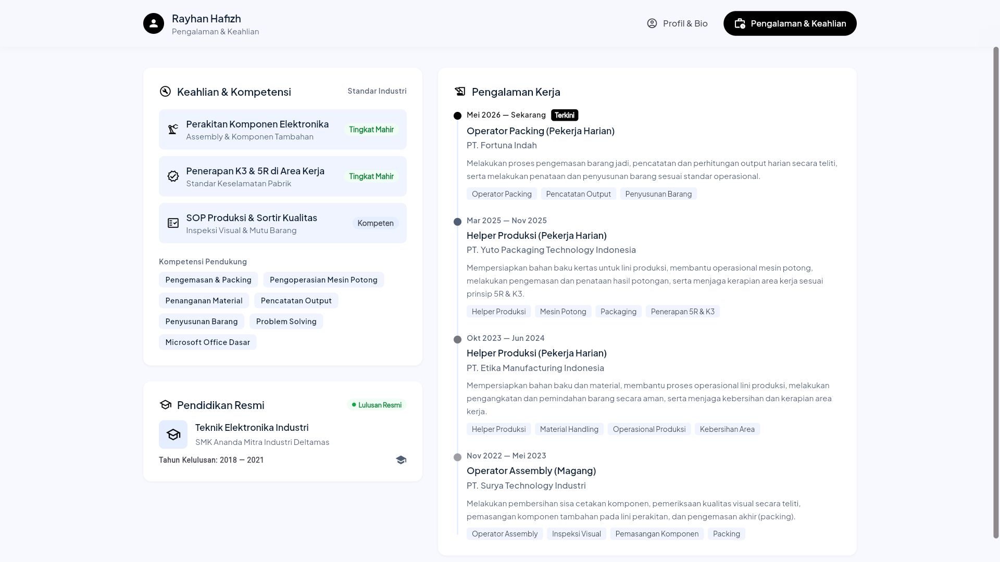

# 💼 Profile Web — Interactive Portfolio & Digital CV

<p align="center">
  
  
  
  
  
</p>

<p align="center">
  Aplikasi Web Portofolio & CV Digital interaktif yang dibangun menggunakan <b>Flutter Web</b> dengan arsitektur bersih berbasis <b>BLoC</b>, <b>Dio</b>, dan <b>Freezed</b>.
</p>

<p align="center">
  <a href="https://faiq-id.github.io/profile_web/">
    
  </a>
</p>

---

## 🖥️ Pratinjau Antarmuka (UI Showcase)

### 1. Tab Profil & Bio
Halaman utama yang menampilkan identitas kandidat, foto profil beresolusi jernih, ringkasan profesional (*About Me*), tombol integrasi WhatsApp langsung, serta ikhtisar keahlian teknis.



### 2. Tab Pengalaman & Keahlian
Halaman portofolio teknis yang menampilkan linimasa riwayat kerja interaktif (*Timeline*), tag kompetensi, serta kartu **Pendidikan Resmi**.



---

## ✨ Fitur Utama

- 📐 **100% Responsif & Adaptif:** Otomatis menyesuaikan antarmuka antara *Dual Column Grid* pada layar Desktop/Laptop (≥840px) dan *Bottom Navigation Bar* pada layar Smartphone (<840px).
- ⚡ **State Management Tangguh (BLoC):** Menggunakan `flutter_bloc` untuk memisahkan *business logic* dengan tampilan UI secara bersih, mengelola status *Loading*, *Loaded*, dan *Error* dengan andal.
- 🔄 **Pemisahan Data Dinamis (JSON-Driven):** Seluruh data profil dan riwayat pekerjaan disimpan di file JSON terpisah (`profile_data.json`) sehingga dapat diperbarui kapan saja tanpa perlu mengubah kode Flutter.
- 🔒 **Privacy-First (Mode Unlisted):** Dikonfigurasi dengan `robots.txt` dan meta-tag anti-crawler agar tidak terindeks oleh mesin pencari Google, menjaga kerahasiaan data privasi kandidat.
- 💬 **Integrasi WhatsApp Sekali Klik:** Tombol kontak yang langsung membuka obrolan WhatsApp dengan template pesan otomatis yang telah disanitasi.
- 🎨 **Desain Elegan & Bersih:** Menerapkan palet warna *slate-dark*, kartu berkontur halus, indikator denyut status kerja (*pulse dot*), dan navigasi *frosted-glass*.

---

## 🛠️ Teknologi & Arsitektur

- **Framework:** [Flutter Web](https://flutter.dev) (Channel Stable)
- **Bahasa Pemrograman:** [Dart](https://dart.dev)
- **State Management:** [`flutter_bloc`](https://pub.dev/packages/flutter_bloc)
- **Networking & Fetching:** [`dio`](https://pub.dev/packages/dio)
- **Data Modeling & Immutability:** [`freezed`](https://pub.dev/packages/freezed) & [`json_serializable`](https://pub.dev/packages/json_serializable)
- **Font & Tipografi:** [Google Fonts (Plus Jakarta Sans)](https://fonts.google.com/specimen/Plus+Jakarta+Sans)
- **CI/CD Deployment:** GitHub Actions ke [GitHub Pages](https://pages.github.com)

---

## 🚀 Menjalankan Proyek Secara Lokal

1. **Clone repositori:**
   ```bash
   git clone https://github.com/faiq-id/profile_web.git
   cd profile_web
   ```

2. **Install dependensi:**
   ```bash
   flutter pub get
   ```

3. **Jalankan di browser Chrome:**
   ```bash
   flutter run -d chrome
   ```
   *Atau jalankan sebagai server web lokal:*
   ```bash
   flutter run -d web-server --web-port 8080
   ```

---

## 👨‍💻 Dikembangkan Oleh

Dibuat dengan ❤️ oleh **[faiq-id](https://github.com/faiq-id)**
